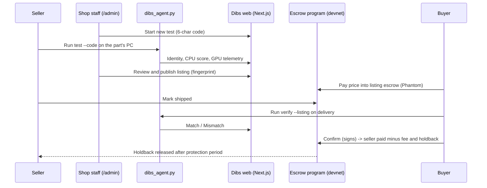

# Dibs

A marketplace for used PC parts you can trust: a partner repair shop tests the part, the buyer pays into a Solana escrow, and the seller is paid only after a check on the buyer's PC confirms it is the same part.

Built for the Colosseum hackathon. Pitch, roadmap and earlier design notes: [docs/PITCH.md](docs/PITCH.md).


<!-- screenshot: add docs/screenshot.png -->

## Features

- **In-shop test while the seller waits.** Staff start a test session, run the Dibs agent on the machine, and watch hardware identity, CPU score and GPU stress telemetry arrive live.
- **Public test report.** Staff review the results, grade the part and publish a listing with a hardware fingerprint (sha256).
- **Escrow on Solana devnet.** Buyers pay in SOL or devnet USDC with Phantom. A 4% fee and a 10% holdback are enforced by the on-chain program.
- **Delivery check.** The buyer runs the same agent in `verify` mode; the result (Match / Mismatch) is shown on the listing.
- **Disputes and claims.** Shop staff resolve disputes and protection-period claims from the staff panel. After a timeout, anyone can trigger the auto-release or refund.
- **Reference scores.** Real Blender Open Data percentiles to compare a part against others of the same model.

## How it works



**Fingerprints** are sha256 hashes, so they fit on-chain as 32 bytes:

- **Part** (graphics card only): `sha256({"gpu": "<uuid>|<vbios>"})`, one per GPU. Matches wherever the card is installed.
- **Device** (laptop / prebuilt): `sha256({"bios": <BIOS serial>, "gpus": [...]})`. The buyer must receive that exact machine.

**Escrow rules** (`program/escrow/src/lib.rs`, mirrored in `web/lib/escrow/math.ts`):

- `confirm` works only after the listing is marked shipped, and the buyer must sign. A Match from `/api/verify` alone never releases money.
- If the buyer stays silent, the seller is paid after the confirm timeout. An unshipped order can be refunded after the ship timeout.
- Timeouts are fixed when the program is initialised: 7 days (ship, confirm, dispute, claim) and 90 days (protection) by default, minimum 60 seconds.

## Quickstart

Requires Node.js and npm. The agent needs Windows, an NVIDIA GPU and Python 3.9+.

```bash
git clone https://github.com/0jz/Dibs.git
cd Dibs/web
npm install
npm run dev:lan          # http://localhost:3000, reachable from other PCs on the LAN
```

- Public site: `http://localhost:3000`
- Staff panel: `http://localhost:3000/admin`. Set `DIBS_ADMIN_PASSWORD` before you use it. In development a built-in fallback password is used when the variable is unset; in production there is no fallback and nobody can log in without it.

Without Redis credentials, data is stored in `web/data/db.json` (gitignored).

### Escrow on devnet (optional)

The `.so` binary is built by the **Build escrow program** GitHub Action (or locally with the Agave toolchain: `cargo build-sbf --manifest-path program/escrow/Cargo.toml`). Put it at `program/escrow/target/deploy/dibs_escrow.so`, then from the repo root:

```bash
cd web && npm install && cd ..
node web/scripts/devnet.mjs
```

This creates `keypairs/` (gitignored), deploys the program with the admin key, initialises it and writes `keypairs/program-id.txt`. Set `ESCROW_TIMEOUT_SECS=120` only for a live demo. Phantom must be set to Devnet; devnet USDC comes from https://faucet.circle.com.

## Configuration

Set these in `web/.env.local` locally or in the Vercel project settings. There is no `.env.example`; this table is taken from the code.

| Variable | Required | Default | Description |
|---|---|---|---|
| `DIBS_ADMIN_PASSWORD` | Yes in production | dev-only fallback | Staff panel password. Without it a production build has no staff login. |
| `DIBS_STORE_NAME` | No | `Dibs Demo Shop · Belgrade` | Shop name shown on reports |
| `KV_REST_API_URL` / `KV_REST_API_TOKEN` | No | — | Upstash Redis (set by the Vercel Marketplace). When present, data lives in Redis instead of `web/data/db.json`. |
| `UPSTASH_REDIS_REST_URL` / `UPSTASH_REDIS_REST_TOKEN` | No | — | Same as above, alternative names |
| `SHOP_KEYPAIR` | For escrow | `keypairs/devnet-admin.json` | Shop/admin signing key as a JSON byte array. Treat as a secret. |
| `NEXT_PUBLIC_PROGRAM_ID` | For escrow | `keypairs/program-id.txt` | Deployed escrow program ID |
| `NEXT_PUBLIC_SOLANA_RPC` | No | `https://api.devnet.solana.com` | RPC override |
| `DIBS_AGENT_URL` | No | `/dibs_agent.py` | Where `/download` redirects (for example the built `dibs-agent.exe`) |
| `ESCROW_TIMEOUT_SECS` | No | 7 / 90 days | Used only by `web/scripts/devnet.mjs` at init time; sets every timeout |

## Usage

### Shop test flow

1. Staff panel → **Start new test**. It shows a 6-character code and the command to run.
2. On the machine being tested, download the agent from `/dibs_agent.py` (or `/download`) and run:
   ```bash
   python dibs_agent.py test --server http://<server-ip>:3000 --code <CODE>
   ```
   Tiers: `--tier light|standard|bench` (default: light on laptops, standard on desktops). `--cpu-seconds`, `--gpu-seconds` and `--memory-seconds` shorten a run. The GPU stress stops early at 80–88 °C depending on tier and device, and laptops only stress on AC power.
3. The panel updates live: hardware read → CPU benchmark → GPU stress (a browser tab opens `/stress`, a WebGL load) → review.
4. Fill in the review form (kind: *part* or *device*, title, grade, seller, price, seal ID, notes) → **Sign & publish listing**.
5. Buyer, on delivery: `python dibs_agent.py verify --server <url> --listing <listing-id>`.

The server address can also come from the `DIBS_SERVER` env var, a `dibs_server.txt` next to the agent, or be baked in at build time. Customers can open `https://<site>/run/<code>` for download-and-run instructions.

### Pages

| Path | What |
|---|---|
| `/` | Listings |
| `/listing/[id]` | Report, escrow box, delivery check result |
| `/verify` | Delivery check |
| `/stress` | WebGL GPU load page (`?profile=phone` for phones) |
| `/run/[code]` | Customer instructions for a test session |
| `/admin` | Staff panel (login required) |

### API

| Method | Path | Access | Purpose |
|---|---|---|---|
| GET, POST | `/api/agent/[code]` | Agent | Upload identity, phase, samples, results |
| GET, POST | `/api/sessions` | Staff | List / start test sessions |
| GET, PATCH, DELETE | `/api/sessions/[id]` | Staff | Read / update / delete a session |
| POST | `/api/sessions/[id]/publish` | Staff | Publish a listing |
| GET, PATCH | `/api/listings/[id]` | Public / staff | Read / update a listing |
| POST | `/api/verify` | Public | Buyer delivery check |
| GET | `/api/reference?q=RTX%203080` | Public | Blender Open Data percentiles |
| GET | `/api/limits?q=<name>` | Public | Warn/stop temperatures for a GPU or CPU |
| GET | `/api/escrow/config` | Public | Program ID, USDC mint, RPC, cluster |
| POST | `/api/escrow/open` | Public | Shop-co-signed transaction the seller signs to open a listing's escrow |
| POST | `/api/escrow/admin` | Staff | Resolve disputes and claims |
| POST | `/api/admin/login`, `/api/admin/logout` | — | Staff session cookie |

## Deploy on Vercel

1. Import the repo with **Root Directory = `web`**.
2. Add **Upstash Redis** from the Vercel Marketplace (sets `KV_REST_API_URL` / `KV_REST_API_TOKEN`). Without it, data goes to a local file that does not persist on Vercel.
3. Set `DIBS_ADMIN_PASSWORD` and the escrow variables from the table above. Mark `SHOP_KEYPAIR` as sensitive.
4. To ship a Windows agent, run the **Build agent** workflow (or push a tag like `agent-v1`) with your public site as the `server` input. It builds `dibs-agent.exe` with PyInstaller; put the release asset URL in `DIBS_AGENT_URL`. The exe is unsigned, so SmartScreen will warn.

## Project structure

```
Dibs/
├── web/                          # Next.js 16 app (site, staff panel, API)
│   ├── app/                      # Pages and API routes (App Router)
│   ├── components/               # UI; admin/SessionLive.tsx is the live test view
│   ├── lib/                      # db.ts (file/Redis), auth.ts, grading, escrow/ client code
│   ├── public/dibs_agent.py      # Test/verify agent (Python, standard library only)
│   ├── reference/                # Blender, phone and limit reference data (JSON)
│   └── scripts/                  # devnet.mjs (deploy + init) and demo seed scripts
├── program/escrow/               # Native Solana escrow program (Rust, solana-program 1.18)
├── scripts/build_blender_reference.py  # Rebuilds web/reference/blender.json
├── .github/workflows/            # Build escrow .so; build dibs-agent.exe
├── ITEM-VERIFICATION.md          # Verification, protection and dispute rules
├── MENTORS.md                    # Brief for hackathon mentors
└── docs/PITCH.md                 # Pitch, roadmap, historical plan
```

## Status & limitations

- **Hackathon demo, Solana devnet only.** Not audited; do not use with real funds.
- Agent supports **Windows + NVIDIA** only. Brave/Firefox hide the GPU name in WebGL; on dual-GPU laptops the browser may render on the integrated GPU (set it to High performance in Windows Graphics settings).
- The seal sticker ID is recorded but not part of either fingerprint.
- Agent output is not attested, so a modified agent could spoof results.
- EUR prices are not locked on-chain; only SOL and USDC listings use escrow.
- `BUILD-PROMPT.md` is the original build plan; parts of it (Anchor, Supabase) were not built that way.

## License

MIT, see [LICENSE](LICENSE).
